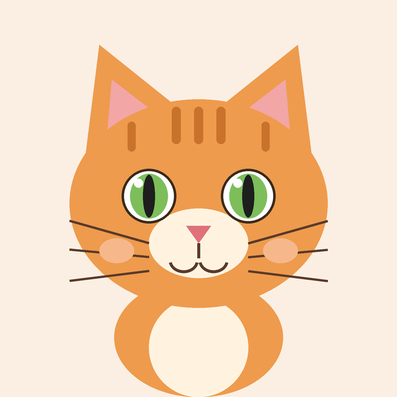

# Todo sobre los gatos

## Introducción

Los gatos son animales **muy independientes**, *curiosos* y cariñosos. Este documento está guardado en el fichero `miprimermd.md`.

```python
class Gato:
    def __init__(self, nombre):
        self.nombre = nombre

    def maullar(self):
        print(f"{self.nombre} dice: miau")
```

Para cuidar bien a un gato hay que seguir estos pasos:

1. Darle agua fresca todos los días.
2. Alimentarlo con comida adecuada.
3. Jugar con él cada día.

Estas son algunas características de los gatos:

- Duermen muchas horas al día.
- Se limpian con la lengua.
- Son muy ágiles.

Más información en la [Wikipedia](https://es.wikipedia.org/wiki/Felis_silvestris_catus).

Otro fichero del repositorio: [README](README.md).



| Raza | Origen | Carácter |
|------|--------|----------|
| Siamés | Tailandia | Hablador |
| Persa | Irán | Tranquilo |
| Maine Coon | Estados Unidos | Sociable |